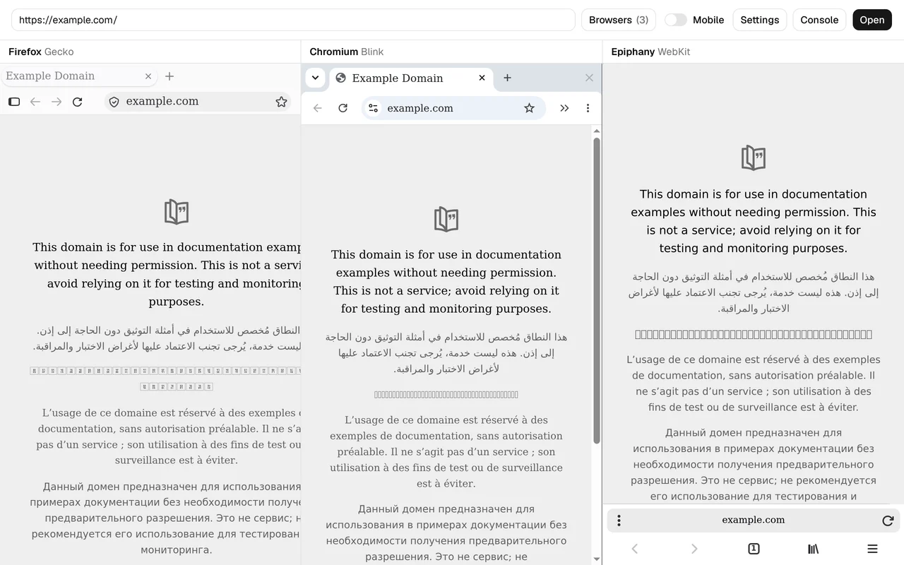

# Side by Side

Open one URL in several real desktop browsers at once and compare how each engine renders it. Every
browser runs in its own Linux VM inside your tab, so there is nothing to install and no server
behind the page.

**[Open Side by Side](https://michidk.github.io/sidebyside/)** · [Use it](#use-it) ·
[How it works](#how-it-works) · [Build and deploy](#build-and-deploy)

[](https://github.com/michidk/sidebyside/actions/workflows/pages.yml)
[](#license)



## Use it

1. Open <https://michidk.github.io/sidebyside/> on a desktop computer with 8 GiB of RAM or more.
2. Type a URL and press **Open**. Firefox (Gecko), Chromium (Blink) and Epiphany (WebKit) each boot
   in their own pane and load it. The first visit takes 1 to 3 minutes while the browsers download;
   later visits reuse the cache.
3. Compare the panes. Each pane is the real browser: click, scroll and type in it as usual.

The toolbar does the rest:

- **Browsers** adds Firefox ESR and NetSurf (its own engine) and sets the order of the panes.
- **Mobile** switches the browsers to a phone-sized window and, except NetSurf, a mobile user
  agent, without rebooting the VMs. Firefox and Chromium switch while they run; Epiphany restarts.
- **Settings** sets the memory per VM, shows each pane's CPU, memory and network use, picks the
  internet relay, and edits each browser's command-line flags.
- **Console** collects the web-console messages of Firefox, Firefox ESR and Chromium in one list.

Open a new URL and the running browsers go there: Firefox and Chromium navigate, Epiphany and
NetSurf restart, and no VM reboots. Changed settings, or Open on the same URL, start the VMs over.

The link keeps everything, so you can share a comparison:
`?url=https://example.com/&browsers=netsurf,firefox&mobile=1`.

## How it works

- **VM:** [unkernel](https://github.com/pithings/unkernel), a Linux kernel compiled to WebAssembly
  that runs aarch64 programs, one per browser in its own iframe (`vm.html`). Each VM gets an even share of your CPU threads (at most 4, 2 in Firefox).
- **Browsers:** the real nixpkgs builds, served to the guest at `/nix/store` by `src/vm/store.ts`.
  Store paths download from cache.nixos.org (which allows cross-origin reads) only when the guest
  first reads a file in them, and each NAR is checked against the NarHash in
  `public/closures/*.json`.
  `scripts/closures.ts` writes those manifests at build time from narinfos whose signatures it
  checks against cache.nixos.org's key.
- **Cache:** downloads go into the page's Cache Storage (`src/vm/fetch-nar.ts`), shared by all the
  VMs: they have most libraries in common, so each is downloaded once, and a second visit
  downloads nothing it already has.
- **Flags:** each browser starts with flags that turn off what testing a page doesn't need
  (updates, telemetry, sync, safe browsing, extra processes). They're in `src/modules/browsers/browsers.ts` and
  editable under Settings → Browser flags; edited flags are saved in the link.
- **Windows:** [wland](https://github.com/pithings/wland) composites the guest's Wayland windows in
  the page; its relay runs in the guest and talks to the page over vsock.
- **Internet:** browsers can't open raw sockets, so the guest's TCP goes over a WebSocket to a
  public [Wisp](https://github.com/MercuryWorkshop/wisp-protocol) relay
  (`wisp.mercurywork.shop`, `anura.pro`). Those relays see which hosts the VMs connect to. Use your
  own with `?wisp=wss://your-relay/`.
- **Remote control:** the page drives Chromium over the DevTools protocol and Firefox over
  WebDriver BiDi, each listening on the guest's `127.0.0.1:9222` and reached through unkernel's
  `vm.connect()` (`src/vm/control.ts`). Websites in Firefox see `navigator.webdriver` as `true`, and
  its address bar shows the remote-control stripes.
- **Isolation:** the VMs need `SharedArrayBuffer`, so the pages load `coi-serviceworker`, which
  adds COOP/COEP on hosts that can't send headers.

## Faster: run the relay on your computer

The public relays are shared and throttled, and websites see their IP address. Running the relay
locally removes that detour, and websites see your own connection. The page has the same steps under
Settings → "Faster: run the relay on your computer…".

1. Install [Node.js](https://nodejs.org/) 18 or newer.
2. Run `npx -p @mercuryworkshop/wisp-js wisp-js-server` and leave it running. It listens on
   `127.0.0.1:5001` only, and refuses connections to private and loopback addresses, so the VMs can't
   reach your home network through it.
3. In Settings, click "Use local relay" (or set the Wisp relay to `ws://127.0.0.1:5001/`, or add
   `&wisp=ws://127.0.0.1:5001/` to the link), then press Open.

## Build and deploy

```sh
bun install
bun run closures   # optional: re-resolve the browsers to the newest aarch64 builds
bun run closures netsurf   # or only the browsers named
bun run dev        # the page with hot reload (builds the VM frame first)
bun run build      # dist/client/: the static site
bun run check      # type-check
bun test
```

Serve `dist/client/` from any static host (GitHub Pages, Cloudflare Pages, Netlify, `python3 -m
http.server -d dist/client`). It must be HTTPS, or localhost, for the service worker. To serve it
from a subpath, build with `BASE_PATH=/subpath/ bun run build`.

Live at <https://michidk.github.io/sidebyside/>: `.github/workflows/pages.yml` deploys every push to
`main`.

The page is a [TanStack Start](https://tanstack.com/start) app built as a static SPA (only its shell
is prerendered; no server code), with [shadcn/ui](https://ui.shadcn.com) components on
[Base UI](https://base-ui.com). Each browser pane is an iframe of the VM frame (`vm.html`), which is
plain TypeScript bundled by Bun: its main thread already runs the compositor.

| Path | What it does |
| --- | --- |
| `src/routes/index.tsx`, `src/routes/-components/` | The page: URL, browser menu, settings, console, one pane per browser |
| `src/routes/-lib/`, `src/routes/-hooks/` | The page's link state, settings checks, frame URLs, and frame messages |
| `src/components/ui/` | shadcn components (`meter.tsx` is Base UI's Meter in the same style) |
| `src/modules/browsers/` | Each browser: packages, launch command, flags, console format |
| `src/modules/vm-frame/messages.ts` | What the page and the VM frames say to each other |
| `src/vm/main.ts`, `src/vm/vm.html` | One VM: boots the kernel, mounts the store, starts the browser |
| `src/vm/store.ts`, `fetch-nar.ts`, `nar.ts` | `/nix/store` as a lazy filesystem: download queue, cache, decompression, checks |
| `src/vm/gui.ts`, `log-view.ts` | The Wayland relay and compositor; the boot log |
| `scripts/build-vm.ts` | Builds the VM frame into `public/`, versioned so browsers never mix builds |
| `scripts/closures.ts` | Resolves and verifies the browsers' closures at build time |

## Limits

- First load takes 1 to 3 minutes and downloads about 800 MiB for the three default browsers. The VMs run
  emulated, so pages are slow, and Epiphany may show "Page Unresponsive" (click Wait).
- The tab needs about 2 GiB of memory per browser shown (6 GiB for the default three).
- Ladybird and Servo don't run in the VM yet: Ladybird's JavaScript engine reserves more address
  space than the guest has, and Servo loads pages but never draws them with software OpenGL.
- There is no GPU: browsers render in software.

## License

Licensed under either of [Apache License, Version 2.0](LICENSE-APACHE) or
[MIT license](LICENSE-MIT) at your option.
